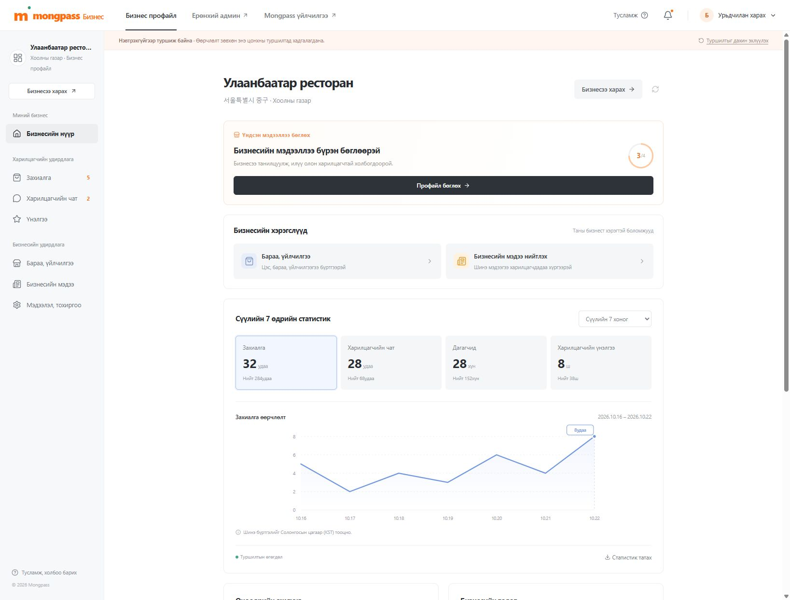
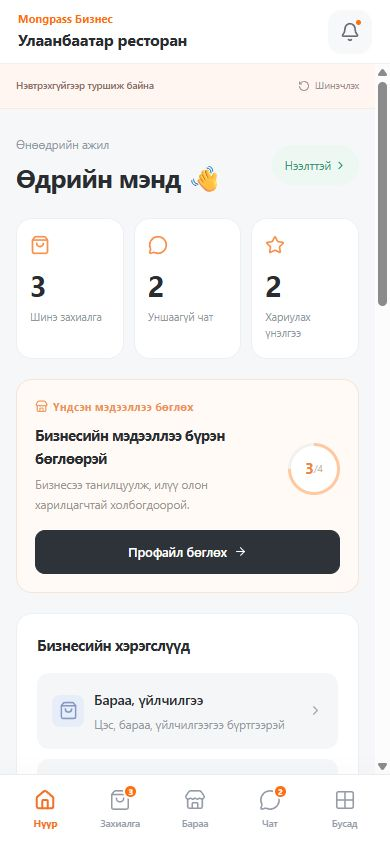

# 관리자 화면 검토 안내

최고관리자(`/admin`, 한국어)와 업체 관리자(`/biz`, 몽골어)를 역할별로
분리합니다. 업체 관리자는 767px 이하에서 하단 탐색 메뉴와 주문 카드,
편집 시트, 고정 저장 버튼을 사용하는 모바일 화면으로 전환됩니다.
로그인 후 세션에 연결된 업체를 조회하며, 업체가 없으면 등록 화면으로
이동합니다. 조회·수정 권한은 서버에서도 검사합니다.

## 로그인 없이 화면 검토

1. `npm run dev`로 로컬 서버를 실행합니다.
2. `/preview/admin`에서 최고관리자 대시보드를 확인합니다. 관리 목록
   링크는 실제 인증 흐름으로 이동합니다.
3. `/preview/biz`에서 업체 관리자 PC 화면을 확인합니다.
4. `/preview/mobile-biz`에서 휴대폰 크기의 업체 관리자 화면을 확인합니다.
5. 업체 체험 화면의 메뉴·소식 등록, 프로필 수정, 주문 상태 변경,
   채팅 전송과 리뷰 답글을 확인합니다. 변경은 해당 탭의
   `sessionStorage`에만 저장됩니다. 초기화 버튼으로 복원할 수 있습니다.

실제 운영 흐름은 `/login?redirect=%2Fbiz`에서 시작합니다. 운영 데이터
저장에는 Google OAuth 설정과 Cloudflare D1/R2 환경이 필요합니다.
체험 화면에서 저장한 내용은 실제 API나 사용자 화면으로 전달되지 않습니다.

## 화면 자료

아래 이미지는 모바일 UI 구현 당시 체험 데이터로 확인한 화면입니다.
통계와 업무 수치는 샘플이며, 서로 다른 시점의 상태일 수 있습니다.

| PC 업체 관리자 | 모바일 업체 관리자 |
| --- | --- |
|  |  |

## 검토 시 유의할 범위

- 실제 업체용 프로필·상품·소식·주문·채팅·리뷰 화면은 API를 사용합니다.
  API 테스트의 세션은 로컬 임시 계정으로 구성하며 Google 로그인 자체를
  대체 검증하지 않습니다.
- Google 로그인부터 실제 업체의 등록 내용이 사용자 화면에 반영되는
  전체 흐름은 실제 개발용 계정으로 최종 확인해야 합니다.
- 푸시 알림은 기존 Web Push 기능을 사용하며 별도의 VAPID 설정과
  실제 지원 기기에서 수신 확인이 필요합니다. 체험 화면에는 연결하지 않습니다.
- 체험용 고객 화면(`/preview/biz/store`)은 업체 기본 정보와 메뉴만
  표시합니다. 체험 소식·사진 표시와 실제 사용자 화면의 전체 재현은
  이번 범위에 포함하지 않습니다.
- `other` 업종은 전용 상품 관리 화면이 없어 업체 프로필로 이동합니다.
  체험용 업종별 상품 화면은 음식점 메뉴를 기준으로 제공합니다.
- 몽골어 문구는 원어민 검수가 필요하며 정식 다국어 locale 분리는
  후속 작업입니다.

## 검증 명령

```powershell
npm run lint
npm test
npm run build
npm run test:api
```

API 테스트는 로컬 D1에 실행별 임시 데이터를 만들고 정리합니다.
실행 중인 개발 서버와 Next.js 출력 폴더를 공유하므로 빌드와 API
테스트는 순서대로 실행합니다.
